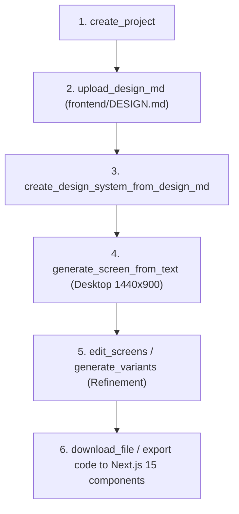

# Google Stitch & React Bits Editorial UI Skill

This skill equips agents and developers with the knowledge, prompts, tool workflows, and React component patterns needed to generate production-grade UI using **Google Stitch** (`stitch.withgoogle.com`) and elevate it with **React Bits** tactile micro-animations into a high-taste, anti-slop frontend.

---

## 1. Principles of Anti-Slop in Google Stitch

When prompting or feeding design systems into Google Stitch, generic AI generation tends to introduce "AI slop": purple gradient blobs, floating cards with 24px blurred drop shadows, cartoon robot vectors, and crowded layouts. 

To maintain the **Linear / Figma editorial standard**, enforce these prompt and style constraints:

1. **One Section Per Viewport (1440×900):** Never ask Stitch for a "dashboard with 8 widgets". Prompt for exactly one clear thought, one headline, and one primary artifact per screen.
2. **Ink Ground & High-Contrast Borders:** Base dark palette `#09090b` or `#0A0E17` with subtle, crisp 1px borders (`#1E293B` or `#27272a`). No diffuse neon glows.
3. **Typography Discipline:**
   - Primary Headings & Body: Swiss / Geometric Sans (`Inter`, `Geist`, or `SF Pro Display`) with tight tracking (`-0.03em`).
   - Metadata & Tags: Monospace uppercase (`JetBrains Mono`) with bracket framing (`[SYSTEM: ARMED]`, `[01/05]`).
4. **Story Over Blueprint:** On the landing page (`/`), present human impact and tangible risk (e.g., Air Canada legal rulings) rather than raw API architectures.
5. **Tactile Motion via React Bits:** Animations must be physically plausible, tactile micro-delights (React Bits `SplitText`, `CountUp`, `CardNav`, `GradualBlur`, `MagneticButton`).

---

## 2. Google Stitch MCP Tool Workflow

When generating screens with the `stitch` MCP tools, follow this exact sequence:



### Key Tool Usage:
1. **`stitch/create_project`**: Initialize a dedicated workspace for the product.
2. **`stitch/upload_design_md`**: Upload `frontend/DESIGN.md` containing strict anti-slop tokens, typography rules, and color palettes.
3. **`stitch/create_design_system_from_design_md`**: Lock in typography, border-radius (`rounded-lg` / `rounded-xl`), and color variables.
4. **`stitch/generate_screen_from_text`**: Generate screens by prompting with specific viewport scenes (e.g., *"Dark editorial hero screen with monospace tag [AEGISX-CORE], 64px crisp headline, and high-contrast CTA button"*).
5. **`stitch/download_file`**: Extract the HTML/CSS markup to convert into clean React 19 / Next.js 15 JSX.

---

## 3. Curated React Bits Animation Components

Layer these lightweight React Bits + Framer Motion components onto Stitch-generated layouts:

### A. Card Nav (`CardNav.tsx`)
A top navigation bar with a frosted glass backdrop and magnetic card hover tracking:

```tsx
'use client';
import { useState, useRef } from 'react';
import { motion } from 'framer-motion';

interface NavItem {
  label: string;
  href: string;
}

export function CardNav({ items, activeHref, onNavigate }: { items: NavItem[]; activeHref?: string; onNavigate?: (href: string) => void }) {
  const [hoveredIdx, setHoveredIdx] = useState<number | null>(null);

  return (
    <nav className="fixed top-6 left-1/2 -translate-x-1/2 z-50 flex items-center gap-1 px-3 py-2 rounded-2xl border border-zinc-800/80 bg-zinc-950/80 backdrop-blur-md shadow-2xl">
      <div className="flex items-center gap-2 mr-3 px-2">
        <div className="w-2 h-2 rounded-full bg-emerald-500 animate-pulse" />
        <span className="font-mono text-xs font-semibold uppercase tracking-widest text-zinc-300">AEGISX</span>
      </div>

      <div className="flex items-center gap-1 relative">
        {items.map((item, idx) => (
          <button
            key={item.href}
            onClick={() => onNavigate?.(item.href)}
            onMouseEnter={() => setHoveredIdx(idx)}
            onMouseLeave={() => setHoveredIdx(null)}
            className="relative px-3.5 py-1.5 text-xs font-medium text-zinc-400 hover:text-white transition-colors rounded-lg"
          >
            {hoveredIdx === idx && (
              <motion.div
                layoutId="cardnav-hover"
                className="absolute inset-0 rounded-lg bg-zinc-800/80 border border-zinc-700/50"
                transition={{ type: 'spring', stiffness: 350, damping: 25 }}
              />
            )}
            <span className="relative z-10">{item.label}</span>
          </button>
        ))}
      </div>

      <button
        onClick={() => onNavigate?.('/app')}
        className="ml-3 px-3 py-1.5 rounded-lg text-xs font-medium bg-white text-zinc-950 hover:bg-zinc-200 transition-all font-mono"
      >
        [ENTER ARENA →]
      </button>
    </nav>
  );
}
```

---

### B. SplitText (`SplitText.tsx`)
Staggered letter-by-letter / word-by-word reveal for bold editorial headlines:

```tsx
'use client';
import { motion } from 'framer-motion';

export function SplitText({
  text,
  className = '',
  delay = 0.03,
}: {
  text: string;
  className?: string;
  delay?: number;
}) {
  const words = text.split(' ');

  return (
    <span className={`inline-block ${className}`}>
      {words.map((word, wordIndex) => (
        <span key={wordIndex} className="inline-block whitespace-nowrap mr-[0.25em]">
          {word.split('').map((char, charIndex) => (
            <motion.span
              key={charIndex}
              initial={{ opacity: 0, y: 12, filter: 'blur(4px)' }}
              animate={{ opacity: 1, y: 0, filter: 'blur(0px)' }}
              transition={{
                duration: 0.4,
                delay: (wordIndex * word.length + charIndex) * delay,
                ease: [0.2, 0.65, 0.3, 0.9],
              }}
              className="inline-block"
            >
              {char}
            </motion.span>
          ))}
        </span>
      ))}
    </span>
  );
}
```

---

### C. CountUp (`CountUp.tsx`)
Smooth numeric count up / down for key performance indicators:

```tsx
'use client';
import { useEffect, useState } from 'react';

export function CountUp({
  from = 0,
  to,
  duration = 1.6,
  decimals = 1,
  suffix = '',
  className = '',
}: {
  from?: number;
  to: number;
  duration?: number;
  decimals?: number;
  suffix?: string;
  className?: string;
}) {
  const [val, setVal] = useState(from);

  useEffect(() => {
    let startTimestamp: number | null = null;
    const step = (timestamp: number) => {
      if (!startTimestamp) startTimestamp = timestamp;
      const progress = Math.min((timestamp - startTimestamp) / (duration * 1000), 1);
      const easeOutQuad = 1 - Math.pow(1 - progress, 3);
      setVal(from + (to - from) * easeOutQuad);
      if (progress < 1) {
        requestAnimationFrame(step);
      }
    };
    requestAnimationFrame(step);
  }, [from, to, duration]);

  return <span className={className}>{val.toFixed(decimals)}{suffix}</span>;
}
```

---

### D. GradualBlur (`GradualBlur.tsx`)
Progressive depth-of-field blur layer that creates cinematic scroll separation:

```tsx
'use client';
export function GradualBlur({
  position = 'bottom',
  height = '120px',
  className = '',
}: {
  position?: 'top' | 'bottom';
  height?: string;
  className?: string;
}) {
  return (
    <div
      style={{ height }}
      className={`pointer-events-none fixed left-0 right-0 z-30 ${
        position === 'top' ? 'top-0' : 'bottom-0'
      } backdrop-blur-[6px] [mask-image:linear-gradient(to_${
        position === 'top' ? 'bottom' : 'top'
      },rgba(0,0,0,1)_0%,transparent_100%)] ${className}`}
    />
  );
}
```

---

### E. SpotlightCard (`SpotlightCard.tsx`)
Subtle cursor-following radial illumination for dark cards:

```tsx
'use client';
import { useRef, useState } from 'react';

export function SpotlightCard({ children, className = '' }: { children: React.ReactNode; className?: string }) {
  const divRef = useRef<HTMLDivElement>(null);
  const [position, setPosition] = useState({ x: 0, y: 0 });
  const [opacity, setOpacity] = useState(0);

  const handleMouseMove = (e: React.MouseEvent<HTMLDivElement>) => {
    if (!divRef.current) return;
    const rect = divRef.current.getBoundingClientRect();
    setPosition({ x: e.clientX - rect.left, y: e.clientY - rect.top });
  };

  return (
    <div
      ref={divRef}
      onMouseMove={handleMouseMove}
      onMouseEnter={() => setOpacity(1)}
      onMouseLeave={() => setOpacity(0)}
      className={`relative overflow-hidden rounded-xl border border-zinc-800 bg-zinc-950 p-8 ${className}`}
    >
      <div
        className="pointer-events-none absolute -inset-px transition-opacity duration-300"
        style={{
          opacity,
          background: `radial-gradient(500px circle at ${position.x}px ${position.y}px, rgba(255,255,255,0.06), transparent 40%)`,
        }}
      />
      {children}
    </div>
  );
}
```

---

### F. BorderBeam (`BorderBeam.tsx`)
Focused laser photon beam traversing card boundaries:

```tsx
'use client';
export function BorderBeam({ size = 200, duration = 8, delay = 0 }: { size?: number; duration?: number; delay?: number }) {
  return (
    <div
      style={{
        '--size': `${size}px`,
        '--duration': `${duration}s`,
        '--delay': `-${delay}s`,
      } as React.CSSProperties}
      className="pointer-events-none absolute inset-0 rounded-[inherit] [border:1.5px_solid_transparent] 
      ![mask-clip:padding-box,border-box] ![mask-composite:intersect] 
      [mask:linear-gradient(transparent,transparent),linear-gradient(white,white)]
      after:absolute after:aspect-square after:w-[var(--size)] after:animate-border-beam after:[animation-delay:var(--delay)] 
      after:[background:linear-gradient(to_left,var(--color-beam-start,#10B981),var(--color-beam-end,#3B82F6),transparent)] 
      after:[offset-anchor:calc(var(--size)/2)_50%] after:[offset-path:rect(0_auto_auto_0_round_calc(var(--size)))]"
    />
  );
}
```

---

### G. MagneticButton (`MagneticButton.tsx`)
Cursor-snapping spring action button:

```tsx
'use client';
import { useRef, useState } from 'react';
import { motion } from 'framer-motion';

export function MagneticButton({ children, onClick, className = '' }: { children: React.ReactNode; onClick?: () => void; className?: string }) {
  const ref = useRef<HTMLButtonElement>(null);
  const [pos, setPos] = useState({ x: 0, y: 0 });

  const handleMouseMove = (e: React.MouseEvent<HTMLButtonElement>) => {
    if (!ref.current) return;
    const { left, top, width, height } = ref.current.getBoundingClientRect();
    const x = (e.clientX - (left + width / 2)) * 0.25;
    const y = (e.clientY - (top + height / 2)) * 0.25;
    setPos({ x, y });
  };

  const handleMouseLeave = () => setPos({ x: 0, y: 0 });

  return (
    <motion.button
      ref={ref}
      onMouseMove={handleMouseMove}
      onMouseLeave={handleMouseLeave}
      animate={{ x: pos.x, y: pos.y }}
      transition={{ type: 'spring', stiffness: 250, damping: 20 }}
      whileHover={{ scale: 1.02 }}
      whileTap={{ scale: 0.98 }}
      onClick={onClick}
      className={`relative px-6 py-3 rounded-lg font-medium transition-colors ${className}`}
    >
      {children}
    </motion.button>
  );
}
```


---

## 4. Veriq-Grade Sleek Engineering & Motion Suite

This suite documents the exact design system, mathematics, shader implementations, and component patterns reverse-engineered from **Veriq** (`veriq.axiomjisu.tech`).

### 1. Typography & Asymmetric Layout Formula
* **Base Tokens:**
  - Signal Blue: `--signal: #4a68ff` (Cobalt punch)
  - Deep Ink Void: `--stage: #07080c`, `--bg: #030407`
  - High-Contrast On-Inverse: `--ink: #eef0f7`, `--inverse: #0b0c10`
  - Technical Muted: `--muted: #8b90a2`
* **The Asymmetric Dual-Column Layout (`.hero-intro`):**
  ```css
  .hero-intro {
    display: grid;
    grid-template-columns: minmax(0, 1.7fr) minmax(0, 1fr);
    align-items: end;
    gap: 32px;
    margin-bottom: 28px;
  }
  ```
* **Headline Specification (`.hero-title`):**
  - Font Size: `clamp(3rem, 7.4vw, 8rem)`
  - Line Height: `1.0`
  - Letter Spacing: `-0.04em`
  - Max Width: `12ch`
  - Italic Accent:
    ```css
    .hero-title em {
      color: var(--signal); /* #4a68ff */
      font-style: normal;
    }
    ```
* **Technical Section Divider:**
  ```tsx
  <div className="w-full flex items-center justify-between py-4 border-b border-white/5 font-mono text-xs text-[#8b90a2] uppercase tracking-widest mb-12">
    <span>01 / Look Closer</span>
    <span className="flex items-center gap-1.5 text-zinc-400">The Story Behind The Signals ↓</span>
    <span>Built by AEGISX Core</span>
  </div>
  ```

---

### 2. Cosmic Stage & Signal Horizon Engine

An elliptical cosmic planetary horizon line with rotated laser meridian lines:

```css
.stage {
  border-radius: 28px;
  background: radial-gradient(120% 90% at 70% 30%, #151a2e 0%, #07080c 62%);
  color: #fff;
  isolation: isolate;
  position: relative;
  overflow: hidden;
  border: 1px solid rgba(255, 255, 255, 0.1);
}

.signal-horizon {
  pointer-events: none;
  z-index: 0;
  position: absolute;
  inset: 0;
  overflow: hidden;
}

.signal-horizon:before {
  content: "";
  background: radial-gradient(at 50% 0, rgba(74, 104, 255, 0.13), transparent 65%);
  border-top: 1px solid rgba(148, 169, 255, 0.28);
  border-radius: 50%;
  width: 150%;
  height: 90%;
  position: absolute;
  top: 51%;
  left: -25%;
  transform: rotate(-7deg);
  box-shadow: 0 -18px 70px -30px rgba(135, 160, 255, 0.5);
}

.signal-horizon span {
  background: linear-gradient(transparent, rgba(148, 169, 255, 0.12), transparent);
  width: 1px;
  height: 70%;
  position: absolute;
  top: 0;
  transform: rotate(8deg);
}
.signal-horizon span:first-child { left: 30%; }
.signal-horizon span:nth-child(2) { left: 67%; }
.signal-horizon span:nth-child(3) { left: 88%; }
```

---

### 3. Interactive SVG Evidence Graph with Mouse Tilt

* **Cubic Bezier Edge Formula:**
  ```ts
  const getCubicBezier = (x1: number, y1: number, x2: number, y2: number) => {
    const midX = (x1 + x2) / 2;
    return `M ${x1} ${y1} C ${midX} ${y1}, ${midX} ${y2}, ${x2} ${y2}`;
  };
  ```
* **Perspective Smoothing Physics:**
  ```tsx
  <g style={{
    transform: `translate(${offset.x}px, ${offset.y}px)`,
    transition: 'transform 600ms cubic-bezier(0.16, 1, 0.3, 1)'
  }}>
  ```
* **Interactive Tooltip Card:** Positioned directly at the active node's SVG coordinates `style={{ left: `${node.x / 900 * 100}%`, top: `${node.y / 360 * 100}%` }}` with `backdrop-filter: blur(12px)`.

---

### 4. WebGL Staggered Particle Morphing Shader (Three.js)

Avoids uniform blob blending by staggering particle dissolution thresholds via `aRand.x`:

```glsl
// Vertex Shader
uniform float uProgress;
uniform float uPointScale;
attribute vec3 aP0;
attribute vec3 aP1;
attribute vec4 aRand;

varying float vAlpha;
varying float vThreat;

void main() {
  float threshold = aRand.x;
  float blend = smoothstep(threshold - 0.15, threshold + 0.15, uProgress);
  vec3 pos = mix(aP0, aP1, blend);
  
  float angle = aRand.y * 6.28318 + uProgress * 0.4;
  mat2 rot = mat2(cos(angle), -sin(angle), sin(angle), cos(angle));
  pos.xz = rot * pos.xz;

  vec4 mvPosition = modelViewMatrix * vec4(pos, 1.0);
  gl_Position = projectionMatrix * mvPosition;
  gl_PointSize = (3.5 * aRand.w + 2.0) * (260.0 / -mvPosition.z) * uPointScale;
  
  vAlpha = 0.6 + 0.4 * sin(aRand.y * 3.14 + uProgress * 2.0);
  vThreat = aRand.z;
}

// Fragment Shader
precision mediump float;
uniform vec3 uColorSignal; // #4a68ff
uniform vec3 uColorBase;   // #dfe5ff
uniform vec3 uColorThreat; // #ff4d57
varying float vAlpha;
varying float vThreat;

void main() {
  vec2 coord = gl_PointCoord - vec2(0.5);
  if (length(coord) > 0.5) discard;
  float edgeAlpha = smoothstep(0.5, 0.2, length(coord)) * vAlpha;
  vec3 color = mix(uColorBase, uColorSignal, 0.7);
  if (vThreat > 0.5) color = uColorThreat;
  gl_FragColor = vec4(color, edgeAlpha);
}
```

---

### 5. Tactical Control Pills & Inverted Luxury Footer

* **Pill Capsule (`.pill.pill-dark`):**
  ```css
  .pill {
    letter-spacing: 0.04em;
    text-transform: uppercase;
    min-height: 44px;
    border-radius: 999px;
    padding: 0 20px;
    font-size: 13px;
    font-weight: 600;
    display: inline-flex;
    align-items: center;
    gap: 10px;
    transition: all 0.3s cubic-bezier(0.16, 1, 0.3, 1);
  }
  .pill-dark {
    background: #ffffff;
    color: #07080c;
    box-shadow: 0 4px 20px -2px rgba(74, 104, 255, 0.45);
  }
  ```
* **Inverted Contrast Footer (`.site-footer`):**
  - Dark upper callout: `Protect the model before you deploy.` with circular magnetic button.
  - Inverted light card (`bg-[#f0f2f7]`) with top corner radius `rounded-t-[48px]`.
  - Massive bottom watermark brand word: `font-size: 17vw; font-weight: 900; line-height: 0.8; opacity: 0.95;`.
